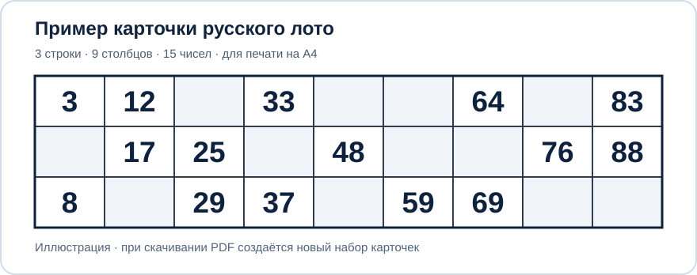

# Генератор карточек Русского лото на А4

**[Открыть бесплатный генератор карточек →](https://mapkepp.github.io/loto-generator/)**

Создавайте карточки для игры в Русское лото прямо в браузере. Это удобно, если карточки закончились, потерялись, нужен новый набор для домашней игры, компании друзей или праздника.

Генератор создаёт **PDF для печати на обычных листах А4**, без регистрации и обязательной оплаты.

## Что можно настроить

- Количество страниц PDF.
- Размеры карточек и расстояние между ними.
- Шрифт и размер чисел, толщину внешней рамки и линий сетки.
- Размер служебных меток с датой и номером карточки.

На одной карточке 3 строки и 9 столбцов, по 5 чисел в строке (всего 15 чисел). При стандартных настройках на странице А4 обычно размещаются 4 карточки; изменение размеров может повлиять на количество.

## Как распечатать

1. [Откройте генератор](https://mapkepp.github.io/loto-generator/).
2. Настройте нужное число страниц и размеры карточек.
3. Нажмите **«Сгенерировать PDF»**, сохраните файл.
4. При печати выберите бумагу **А4**, проверьте масштаб и сначала распечатайте пробный лист.

Приложение бесплатно и доступно всем сразу, без регистрации. Пожертвования необязательны, дополнительного функционала за них нет; ссылки на добровольную поддержку размещены на [странице генератора](https://mapkepp.github.io/loto-generator/#donations).

## Поисковые системы

- Основной адрес: https://mapkepp.github.io/loto-generator/
- Карта сайта: https://mapkepp.github.io/loto-generator/sitemap.xml

Публикация карты сайта не гарантирует индексацию. Для подтверждения индексации нужно добавить URL-prefix ресурс в Google Search Console и Яндекс Вебмастер, подтвердить права и отправить sitemap.

Проект предназначен для самостоятельного изготовления игровых карточек и не является официальным сервисом организаторов коммерческих лотерей.
